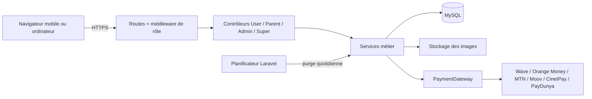
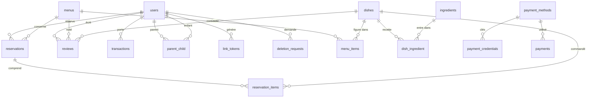

# Cantine de Vatel

Application de gestion de cantine scolaire et d'entreprise, réalisée pour le hackathon **« Cantine de Vatel »** (Vatel Hotel & Tourism Business School, Abidjan, 2026).

Les élèves et le personnel consultent le menu, réservent leur repas depuis leur téléphone, paient avec leur solde ou par Mobile Money et récupèrent leur plateau en présentant un QR code. Les parents rechargent et suivent le compte de leurs enfants. L'administration sait chaque matin combien de repas préparer, gère ses stocks, modère les avis et est alertée des réservations à risque allergique.

---

## Sommaire

1. [Le problème](#1-le-problème)
2. [La solution](#2-la-solution)
3. [Fonctionnalités du guide : couverture](#3-fonctionnalités-du-guide--couverture)
4. [Rôles et droits d'accès](#4-rôles-et-droits-daccès)
5. [Fonctionnalités par rôle](#5-fonctionnalités-par-rôle)
6. [Essayer la maquette interactive](#6-essayer-la-maquette-interactive)
7. [Architecture et choix techniques](#7-architecture-et-choix-techniques)
8. [Modèle de données](#8-modèle-de-données)
9. [Écrans et routes](#9-écrans-et-routes)
10. [Installation de l'application Laravel](#10-installation-de-lapplication-laravel)
11. [Sécurité](#11-sécurité)
12. [Structure du dépôt](#12-structure-du-dépôt)
13. [Ce que nous ferions avec plus de temps](#13-ce-que-nous-ferions-avec-plus-de-temps)
14. [Auteur](#14-auteur)

---

## 1. Le problème

Les cantines scolaires et d'entreprise font face à cinq difficultés quotidiennes :

| Difficulté | Conséquence |
| --- | --- |
| Longues files d'attente aux heures de pointe | Temps de pause perdu, élèves qui renoncent au repas |
| Gaspillage faute de planification | Portions préparées et jetées, coût matière en hausse |
| Régimes et allergies mal pris en compte | Risque sanitaire pour les convives allergiques |
| Manque de transparence sur les menus et les tarifs | Parents et convives mal informés |
| Gestion manuelle fastidieuse | Comptages, stocks et rapports faits à la main |

## 2. La solution

| Difficulté | Réponse de l'application |
| --- | --- |
| Files d'attente | Réservation à l'avance avec **créneau de passage** (11h30, 12h00, 12h30, 13h00, capacité par créneau) et **QR code** scanné au comptoir en quelques secondes |
| Gaspillage | Heure limite de réservation, **prévision par plat et par jour**, mesure des repas non retirés, question « Avez-vous tout mangé ? » après le repas |
| Allergies | Allergies déclarées dans le profil, plats incompatibles **signalés et filtrables**, **alerte à l'administration** si un convive réserve malgré tout un plat à risque, avertissement renforcé au comptoir |
| Transparence | Menu de la semaine public, prix, ingrédients, allergènes et avis visibles sur chaque fiche plat |
| Gestion manuelle | Tableau de bord, commandes du jour, stocks calculés depuis les recettes, rapports exportables, statistiques par classe |

## 3. Fonctionnalités du guide : couverture

**Fonctionnalités minimum requises**

| Exigence | Où | État |
| --- | --- | --- |
| Inscription et connexion | C2, C3 | Fait |
| Consultation du menu de la semaine | U2 | Fait |
| Réservation d'un repas | U4, U5 | Fait (plusieurs plats, quantités, créneau) |
| Affichage du solde et historique | U1, U6 | Fait |
| Création / modification des menus | A2 | Fait (glisser-déposer depuis le catalogue) |
| Visualisation des commandes du jour | A3 | Fait (par créneau et prévision par jour) |
| Tableau de bord avec statistiques de base | A1 | Fait |

**Fonctionnalités bonus**

| Bonus | État |
| --- | --- |
| Système de notation des plats | Fait : avis sur chaque plat et/ou sur le menu, modération |
| Suggestions de repas personnalisées (IA) | Fait : moteur de recommandation par règles (historique, notes, allergies). Un modèle d'IA pourra le remplacer |
| Multi-langue (français ou anglais) | Fait pour les espaces élève, personnel et parent. L'administration reste en français |
| Application mobile | Interface web pensée mobile d'abord, installable sur l'écran d'accueil. Pas d'application Android/iOS native |
| Paiement Mobile Money (Wave, Orange Money) | Interface prête et configurable (Wave, Orange Money, MTN MoMo, Moov Money, carte, CinetPay, PayDunya). Paiements simulés en démo |
| Notifications en temps réel | Notifications internes (réservation, solde bas, repas servi, alertes allergie). Notifications push : prévues |
| Mode hors ligne | QR code de réservation consultable hors ligne. Prévu : mise en cache du menu |

## 4. Rôles et droits d'accès

| Rôle | Qui | Accès |
| --- | --- | --- |
| Utilisateur | Élève ou Personnel, type choisi à l'inscription | Ses menus, réservations, portefeuille, avis et profil |
| Parent | Parent d'un ou plusieurs élèves | Enfants liés par QR code : suivi des repas, recharge, alertes |
| Administrateur | Gestionnaire de la cantine | Plats, menus, commandes, comptoir, stocks, avis, statistiques, rapports |
| Super administrateur | Niveau le plus élevé | Tout l'administrateur, plus : administrateurs, corbeille, demandes de suppression, moyens de paiement, journal d'audit |

Chaque groupe de routes est protégé par un middleware de rôle. Un administrateur qui ouvre un écran de super administration reçoit une erreur **403**. Un compte désactivé ou en corbeille est déconnecté à la requête suivante.

## 5. Fonctionnalités par rôle

### Utilisateur (élève ou personnel)

- **Profil** : nom et prénom obligatoires. Champs facultatifs selon le type : classe et matricule pour un élève, poste pour le personnel. Ils sont modifiables ou vidables à tout moment. Un indicateur discret, non bloquant, signale un profil incomplet.
- **Photo de profil** : depuis la galerie ou l'appareil photo, recadrage carré ou cercle, compression automatique en WebP. Formats JPG, PNG et WebP, 5 Mo maximum (« Image trop lourde (5 Mo maximum) »). Suppression confirmée, initiales par défaut.
- **Confirmation de classe** : à chaque nouvelle période scolaire, « Êtes-vous toujours en 3e A ? » (confirmer ou corriger). Sans classe renseignée, proposition de l'ajouter (ignorable).
- **Menu** : filtres par jour, catégorie (entrée, plat, dessert, boisson), régime (végétarien, sans porc) et allergies. Fiche plat avec photo, description, ingrédients, allergènes et avis.
- **Réservation** : plusieurs plats et quantités pour un même jour, choix du créneau, paiement par le solde ou complément Mobile Money. Modification ou annulation jusqu'à l'heure limite fixée par l'administration, remboursement immédiat sur le solde.
- **Historique et QR code** : réservations à venir et passées, QR code et code de secours à 6 chiffres.
- **Portefeuille** : solde, recharge Mobile Money, historique des transactions et reçus.
- **Avis** : note et commentaire sur chaque plat commandé et/ou sur le menu entier. Réservé aux convives ayant réservé ce menu.
- **Suppression de compte** : demande avec motif facultatif, transmise au super administrateur.
- **Langue** : français (par défaut) ou anglais, enregistrée par compte.

### Parent

- **Liaison** : scan du QR code affiché dans le profil de l'élève, sans utiliser le matricule. Code de secours en saisie manuelle.
- **Plusieurs enfants** depuis un seul compte.
- **Suivi** : repas de la semaine, réservations à venir, équilibre alimentaire, dépenses, allergies déclarées, plafond journalier.
- **Recharge** du compte d'un enfant (Mobile Money ou carte), recharge automatique sous un seuil, historique et reçus.
- **Alertes** : solde bas (seuil réglable par enfant), repas réservé ou servi, messages de la cantine.

### Administrateur

- **Tableau de bord** : réservations et recettes du jour, taux de retrait, note moyenne, affluence par créneau, gaspillage, réservations par classe, prévision par plat, alertes de stock, bandeau des réservations à risque allergique.
- **Alertes** : notification à chaque réservation d'un plat contenant un allergène déclaré par le convive. Depuis l'alerte : voir la commande, contacter le parent ou le convive, marquer comme vérifié.
- **Menus** : planification de la semaine par glisser-déposer depuis le catalogue, portions prévues, duplication de la semaine précédente, publication avec notification des convives.
- **Commandes du jour** : quantités par plat et par créneau, prévision de la semaine par plat et par jour, filtres (créneau, statut, « allergène réservé »), fiche de production imprimable, clôture de la journée.
- **Comptoir** : scan du QR code ou saisie du code. Résultat immédiat : validé, mauvais créneau, déjà servi ou code invalide. Alerte allergie renforcée.
- **Plats et recettes** : création, modification, archivage ou suppression. Photo depuis l'ordinateur ou le téléphone (recadrage, compression, image par défaut par catégorie), aperçu de la fiche avant publication, recette reliée aux stocks.
- **Stocks** : besoins calculés à partir des menus et des recettes, seuils d'alerte, entrées, pertes, bon de commande.
- **Modération des avis** : tri, filtres (plat ou menu, signalés, publiés, masqués), masquage avec motif. Signalement automatique des avis contenant un mot interdit (liste modifiable).
- **Statistiques par classe** : uniquement pour les élèves ayant renseigné leur classe.
- **Rapports** : fréquentation, recettes, gaspillage, satisfaction, classes, stocks. Export CSV et impression PDF.
- **Utilisateurs et paramètres** : consultation des comptes, ajustement manuel du solde, créneaux et capacités, heure limite, démarrage d'une nouvelle période scolaire.

### Super administrateur

- **Administrateurs** : créer, modifier, changer de rôle, désactiver.
- **Suppression de comptes en deux phases**
  - *Phase 1, corbeille* : le compte ne peut plus se connecter et n'apparaît plus. Toutes les données sont conservées. Motif obligatoire. Restauration possible. L'utilisateur et son parent sont notifiés.
  - *Phase 2, suppression définitive* : uniquement sur un compte déjà en corbeille, après avoir retapé le nom du compte ou son mot de passe. Les données personnelles sont effacées. Les réservations sont anonymisées et les avis affichés « Utilisateur supprimé ».
  - *Purge automatique* après 30 jours en corbeille (durée paramétrable).
- **Demandes de suppression** : accepter (le compte passe en corbeille) ou refuser avec un message de justification.
- **Moyens de paiement** : clés API par moyen et par environnement (Test et Production). Activation sans perte des clés. « Tester la connexion » obligatoire avant la mise en service. Clés chiffrées, masquées (`sk_live_••••••••4F2a`) et jamais réaffichées. Ressaisie du mot de passe avant toute modification.
- **Journal d'audit** : désactivations, suppressions, restaurations, changements de rôle, clés API, vérifications d'allergie (qui, quand, quoi). Export CSV.

## 6. Essayer la maquette interactive

La maquette couvre l'ensemble des écrans et des parcours. Elle fonctionne **sans installation, sans serveur et sans connexion internet**.

```
maquette/index.html   →  ouvrir dans Chrome, Edge, Firefox ou Safari
```

Toutes les données sont en mémoire : « Réinitialiser » (ou un rechargement de la page) remet la démo à zéro.

**Barre de démonstration** (en haut de l'écran) : changer de rôle en un clic, et changer l'heure (09:40 : réservations du jour ouvertes ; 12:10 : service du midi).

**Comptes de démonstration** (n'importe quel mot de passe ; pour une ressaisie super admin : 6 caractères ou plus)

| Rôle | E-mail |
| --- | --- |
| Élève | awa.kone@vatel.ci |
| Personnel | jm.aka@vatel.ci |
| Parent | i.kone@gmail.com |
| Administrateur | gestion@cantine-vatel.ci |
| Super administrateur | superadmin@cantine-vatel.ci |
| Comptoir (écran administrateur A11) | comptoir1@cantine-vatel.ci |

**Parcours de démonstration conseillé (10 minutes)**

1. **Admin › Menus** : ajouter un plat par glisser-déposer, publier le menu.
2. **Élève › Menu** : le riz sauce arachide est signalé incompatible. Réserver attiéké et bissap, créneau 12h00, obtenir le QR code.
3. **Élève** : réserver malgré tout un plat contenant l'allergène, puis **Admin › Alertes** : l'alerte est arrivée. Contacter le parent, marquer comme vérifié.
4. **Comptoir** (heure 12:10) : « Simuler un scan ». Le repas est validé avec l'alerte allergie.
5. **Admin › Tableau de bord** et **Commandes** : le repas apparaît servi, la prévision se met à jour.
6. **Parent** : alerte de solde bas de Yao, recharge Wave (simulée), liaison d'un nouvel enfant par QR.
7. **Élève** : noter un plat et le menu. **Admin › Avis** : un avis contenant un mot interdit est signalé.
8. **Super admin** : moyens de paiement (ressaisie du mot de passe, clés masquées), corbeille, journal d'audit.

**Ce qui est simulé dans la maquette** : caméra (scan QR), appels aux fournisseurs de paiement, chiffrement des clés, envoi des SMS et e-mails, génération des PDF, purge planifiée (déclenchée par un bouton). Dans l'application Laravel, ces points sont traités côté serveur (voir sections 7 et 11).

## 7. Architecture et choix techniques

Un **monolithe Laravel rendu côté serveur** en Blade, avec Tailwind CSS et quelques bibliothèques JavaScript légères. Ce choix tient en une journée de hackathon, se déploie sur un simple hébergement PHP et reste lisible.

| Couche | Choix | Pourquoi |
| --- | --- | --- |
| Framework | Laravel 11 (PHP 8.2+) | Authentification, validation, migrations, chiffrement et planificateur de tâches inclus |
| Interface | Blade + Tailwind CSS | Pages rendues côté serveur, mobile d'abord, aucun framework JavaScript à apprendre |
| JavaScript | Cropper.js, qrcodejs, html5-qrcode | Recadrage des images, affichage et scan des QR codes avec la caméra du téléphone |
| Icônes | SVG en ligne (style Lucide / SF Symbols) | Aspect d'application native, aucune requête externe |
| Base de données | MySQL en production, SQLite en développement | Gratuit, disponible chez tous les hébergeurs courants |
| Images | Extension GD de PHP | Recadrage, redimensionnement et compression WebP côté serveur, sans dépendance |
| Paiements | Interface `PaymentGateway` + un pilote par moyen | Ajouter Wave, CinetPay ou PayDunya sans toucher au reste. Pilote « simulé » en environnement Test |
| Tâches planifiées | Planificateur Laravel | Purge quotidienne de la corbeille |
| Traductions | Fichiers `lang/fr.json` et `lang/en.json` | Langue choisie par l'utilisateur et enregistrée sur son compte |

**Organisation du code** : un dossier de contrôleurs par rôle (`User`, `Parent`, `Admin`, `Super`) et la logique métier dans des services réutilisables.

| Service | Rôle |
| --- | --- |
| `ImageService` | Validation, recadrage, compression des photos de profil et de plats |
| `ReservationService` | Heure limite, capacité des créneaux, débit du solde, remboursement, détection des allergènes |
| `AccountService` | Corbeille, restauration, suppression définitive et anonymisation |
| `ModerationService` | Détection des mots interdits dans les avis |
| `AuditLogger` | Trace qui a fait quoi, et quand |



## 8. Modèle de données

19 tables métier, plus les tables standard de Laravel (sessions, cache, jobs). Le compte utilisateur est au centre. Les tables qui doivent survivre à une suppression définitive (réservations, avis, transactions) ont une clé `user_id` nullable : elles sont **anonymisées** au lieu d'être effacées.

| Table | Champs clés | Relations |
| --- | --- | --- |
| `users` | role (user, parent, admin, super_admin), account_type (eleve, personnel), first_name, last_name, email, class_name, matricule, position, avatar_path, balance, allergies, diets, locale, class_confirmed_for, status (active, disabled, trashed), trashed_at, trash_reason | Centre du modèle |
| `parent_child` | parent_id, child_id, linked_at | users ↔ users (plusieurs à plusieurs) |
| `link_tokens` | child_id, token, expires_at, used_at | Jeton du QR de liaison, valable 15 min, usage unique |
| `dishes` | name, category, price, description, image_path, kcal, allergens, diets, deleted_at | Suppression douce pour garder l'historique |
| `ingredients` | name, unit, stock, threshold | — |
| `dish_ingredient` | dish_id, ingredient_id, quantity | Recette : dishes ↔ ingredients |
| `menus` | date (unique), is_published | Un menu par jour |
| `menu_items` | menu_id, dish_id, planned_portions | menus ↔ dishes |
| `reservations` | user_id (nullable), menu_id, slot, status (paid, served, missed, cancelled), code, total, class_snapshot, booked_by, served_at, allergy_conflict, allergy_checked_by | users 1-n, menus 1-n |
| `reservation_items` | reservation_id, dish_id, quantity, unit_price | Plusieurs plats par réservation |
| `reviews` | user_id (nullable), menu_id, dish_id (nullable), rating, comment, status (visible, flagged, hidden), flag_reason, moderated_by | Avis sur un plat (dish_id renseigné) ou sur le menu (dish_id vide) |
| `transactions` | user_id (nullable), type (topup, meal, refund, adjustment), amount, label, reference | Historique du portefeuille |
| `payments` | payer_id, beneficiary_id, payment_method_id, amount, status, environment, provider_reference | Recharges Mobile Money |
| `payment_methods` | code, name, is_active, environment (test, live) | 1-n payment_credentials |
| `payment_credentials` | payment_method_id, environment, key_name, value (chiffrée), last4 | Clés distinctes par environnement |
| `deletion_requests` | user_id, reason, status (pending, accepted, refused), response_message, handled_by | Traitées par le super admin |
| `audit_logs` | actor_id, action, target_type, target_id, details, ip, created_at | Journal non modifiable |
| `app_notifications` | user_id, title, body, url, kind, reservation_id, read_at | Notifications internes, alertes allergie |
| `settings` | key, value | Heure limite, période scolaire, durée de corbeille, mots interdits |



**Statistiques par classe** : `class_snapshot` copie la classe de l'élève au moment de la réservation. Les statistiques restent justes après un changement de classe ou une suppression de compte.

**Suppression définitive** : les données personnelles de la ligne `users` sont effacées et la photo supprimée, les liens parent retirés. Dans `reservations`, `reviews` et `transactions`, `user_id` passe à `NULL`. Un avis sans auteur s'affiche « Utilisateur supprimé ».

## 9. Écrans et routes

42 écrans (les 41 de l’inventaire v2, plus A12 Alertes). Le détail de chaque écran (contenu, actions, états, parcours) est dans le document *Inventaire des écrans et wireframes textuels* du projet.

| Rôle | Écran | Route |
| --- | --- | --- |
| Commun | C1 Accueil public | `/` |
| Commun | C2 Inscription (Élève, Personnel ou Parent) | `/inscription` |
| Commun | C3 Connexion | `/connexion` |
| Commun | C4 Profil (champs selon le type, profil incomplet, langue) | `/profil` |
| Commun | C5 Notifications | `/notifications` |
| Commun | C6 Confirmation du mot de passe | `/confirmer-mot-de-passe` |
| Utilisateur | U1 Accueil + confirmation de classe | `/accueil` |
| Utilisateur | U2 Menu de la semaine (filtres) | `/menu` |
| Utilisateur | U3 Fiche plat | `/plats/{plat}` |
| Utilisateur | U4 Réserver (plusieurs plats, quantités, créneau) | `/reservations/nouvelle/{menu}` |
| Utilisateur | U5 Mes réservations + QR code | `/reservations` |
| Utilisateur | U6 Portefeuille | `/portefeuille` |
| Utilisateur | U7 Recharger | `/portefeuille/recharger` |
| Utilisateur | U8 Avis sur les plats et le menu | `/avis/{menu}` |
| Utilisateur | U10 Photo de profil (modale) | `/profil` |
| Utilisateur | U11 Confirmation de classe (modale) | `/accueil` |
| Utilisateur | U12 QR code de liaison parent | `/profil/qr-parent` |
| Utilisateur | U13 Demande de suppression de compte | `/profil/suppression` |
| Parent | P1 Accueil | `/parent` |
| Parent | P2 Lier un enfant (scan du QR) | `/parent/lier` |
| Parent | P3 Suivi d'un enfant | `/parent/enfants/{enfant}` |
| Parent | P4 Recharger le compte d'un enfant | `/parent/enfants/{enfant}/recharger` |
| Parent | P5 Historique des paiements | `/parent/paiements` |
| Parent | P6 Alertes | `/parent/alertes` |
| Admin | A1 Tableau de bord | `/admin` |
| Admin | A2 Menus de la semaine | `/admin/menus` |
| Admin | A3 Commandes du jour et prévision | `/admin/commandes` |
| Admin | A4 Stocks | `/admin/ingredients` |
| Admin | A5 Plats et recettes | `/admin/plats` |
| Admin | A6 Rapports | `/admin/rapports` |
| Admin | A7 Utilisateurs (consultation) | `/admin/utilisateurs` |
| Admin | A8 Modération des avis | `/admin/avis` |
| Admin | A9 Statistiques par classe | `/admin/statistiques/classes` |
| Admin | A10 Paramètres | `/admin/parametres` |
| Admin | A11 Comptoir | `/admin/comptoir` |
| Admin | A12 Alertes (allergies) | `/admin/alertes` |
| Super admin | S1 Administrateurs | `/super/admins` |
| Super admin | S2 Comptes | `/super/comptes` |
| Super admin | S3 Corbeille | `/super/corbeille` |
| Super admin | S4 Demandes de suppression | `/super/demandes` |
| Super admin | S5 Moyens de paiement | `/super/paiements` |
| Super admin | S6 Journal d'audit | `/super/audit` |

## 10. Installation de l'application Laravel

### Prérequis

- PHP 8.2 ou plus, avec les extensions `gd`, `pdo_mysql` (ou `pdo_sqlite`), `mbstring`, `openssl`, `fileinfo`
- Composer 2
- Node.js 20 et npm
- MySQL 8 (ou SQLite pour le développement)

### Étapes

```bash
# 1. Récupérer le code
git clone <url-du-depot> cantine-vatel
cd cantine-vatel

# 2. Dépendances
composer install
npm install

# 3. Configuration
cp .env.example .env
php artisan key:generate          # génère APP_KEY, utilisée aussi pour chiffrer les clés API

# 4. Base de données (renseigner DB_* dans .env), tables et données de démonstration
php artisan migrate --seed

# 5. Images téléversées accessibles publiquement
php artisan storage:link

# 6. Compilation de l'interface (Tailwind)
npm run build                     # ou « npm run dev » pendant le développement

# 7. Lancement
php artisan serve                 # http://127.0.0.1:8000
```

Pour la purge automatique de la corbeille, lancer le planificateur :

```bash
php artisan schedule:work         # en développement
# en production, une seule ligne cron :
# * * * * * cd /chemin/vers/cantine-vatel && php artisan schedule:run >> /dev/null 2>&1
```

### Variables d'environnement propres au projet

| Variable | Rôle | Exemple |
| --- | --- | --- |
| `APP_LOCALE` | Langue par défaut de l'interface | `fr` |
| `CANTINE_CUTOFF` | Heure limite de réservation le jour même (modifiable dans A10) | `10:00` |
| `CANTINE_TRASH_DAYS` | Jours en corbeille avant purge (modifiable par le super admin) | `30` |
| `PAYMENT_ENV` | Environnement de paiement actif | `test` |
| `UPLOAD_MAX_KB` | Taille maximale des images | `5120` |

Les clés des fournisseurs de paiement ne se mettent **pas** dans `.env` : le super administrateur les saisit dans l'écran S5, où elles sont chiffrées en base.

## 11. Sécurité

| Sujet | Mesure |
| --- | --- |
| Contrôle d'accès | Middleware `role:` sur chaque groupe de routes et policies sur chaque action. Un administrateur reçoit 403 sur `/super/*` |
| Comptes désactivés | Middleware qui déconnecte un compte désactivé ou en corbeille à la requête suivante |
| Fichiers | Validation dans le navigateur (taille, format), puis côté serveur : `mimes:jpg,jpeg,png,webp`, `max:5120`, vérification du type réel par GD, ré-encodage WebP |
| Clés API | Chiffrées par `Crypt::encryptString` (AES-256, clé `APP_KEY`). Seuls les 4 derniers caractères sont gardés en clair pour l'affichage masqué. Jamais renvoyées au navigateur |
| Actions sensibles | Ressaisie du mot de passe (règle `current_password`) avant toute modification des moyens de paiement ou suppression définitive |
| Traçabilité | Journal d'audit non modifiable pour les désactivations, suppressions, restaurations, changements de rôle et clés API |
| Formulaires et sessions | Jeton CSRF, mots de passe hachés (bcrypt), session régénérée à la connexion |
| Données personnelles | Suppression en deux phases, anonymisation des données statistiques, purge automatique |
| Allergies | Contrôle à la réservation, alerte à l'administration, avertissement au comptoir |

## 12. Structure du dépôt

```
cantine-vatel/
├── README.md
├── maquette/                       Maquette interactive HTML/CSS/JS (sans installation)
│   ├── index.html
│   ├── css/style.css
│   ├── img/vatel_logo.png
│   └── js/
│       ├── data.js                 Données de démonstration
│       ├── core.js                 Routeur, contrôle d'accès, images, audit, graphiques
│       ├── icons.js                Jeu d'icônes SVG
│       ├── i18n.js                 Traduction français / anglais
│       ├── screens-user.js         Écrans communs, utilisateur, parent
│       ├── screens-admin.js        Écrans administrateur et comptoir
│       └── screens-super.js        Écrans super administrateur
├── app/
│   ├── Http/Controllers/{User,Parent,Admin,Super}/
│   ├── Http/Middleware/            EnsureRole, EnsureAccountActive
│   ├── Models/
│   ├── Policies/
│   ├── Services/                   ImageService, ReservationService, AccountService, ModerationService, AuditLogger
│   └── Payments/                   PaymentGateway + pilotes (Simulated, Wave, OrangeMoney, CinetPay…)
├── database/migrations/ et database/seeders/
├── lang/fr.json, lang/en.json
├── resources/views/{user,parent,admin,super,components}/
└── routes/web.php
```

## 13. Ce que nous ferions avec plus de temps

- Brancher les API réelles de Wave, Orange Money et CinetPay sur l'interface `PaymentGateway`.
- Notifications push (PWA) et SMS pour les alertes de solde bas et d'allergie.
- Mode hors ligne complet : menu et QR code mis en cache sur le téléphone.
- Remplacer le moteur de suggestions par règles par un modèle entraîné sur l'historique des réservations et des avis.
- Application mobile native (Android d'abord) réutilisant les mêmes routes en API.
- Tableau de bord nutritionnel pour les parents et l'infirmerie scolaire.

## 14. Auteur

**CAMARA Aimé** : développeur web et designer graphique, Abidjan.
Projet réalisé pour le hackathon « Cantine de Vatel », novembre 2026.
