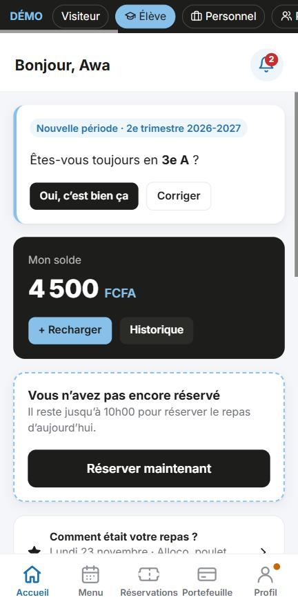
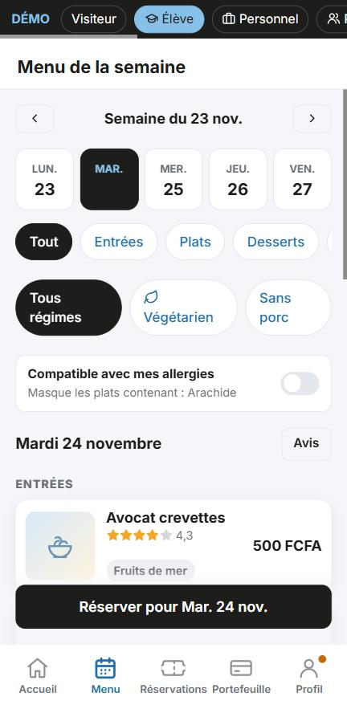
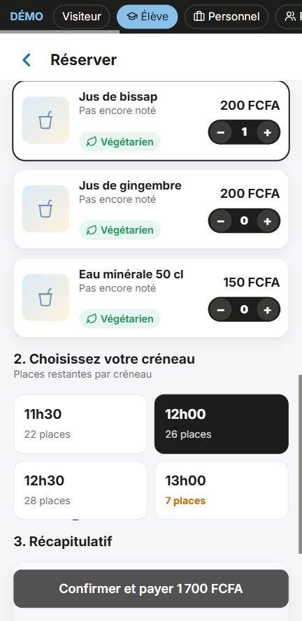
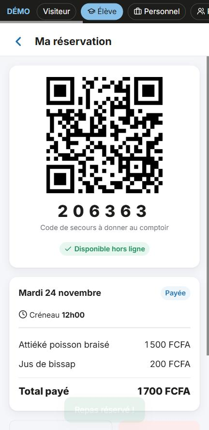
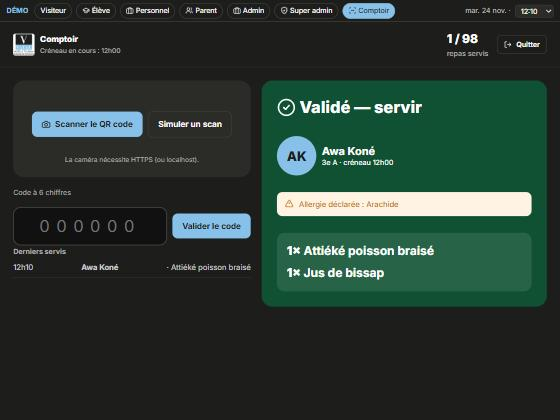
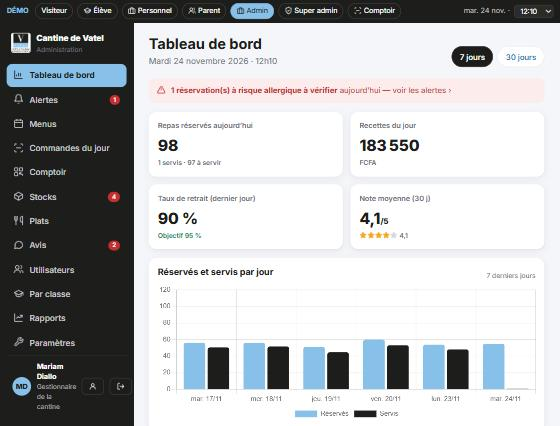
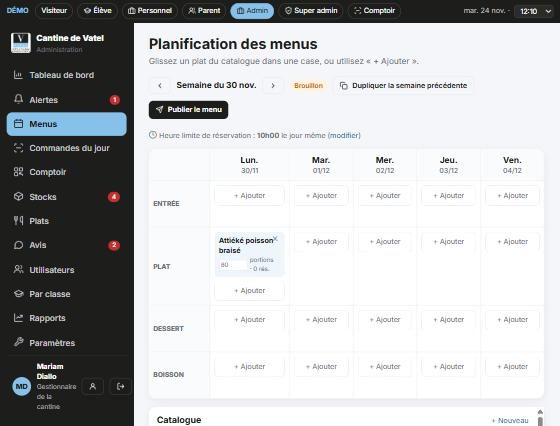
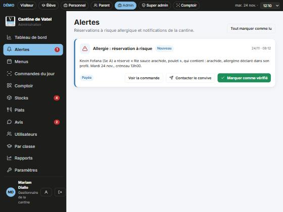

# Cantine de Vatel

Application de gestion de cantine scolaire et d'entreprise, réalisée pour le hackathon **« Cantine de Vatel »** (Vatel Hotel & Tourism Business School, Abidjan, Novembre 2026).

Les élèves et le personnel consultent le menu, réservent leur repas depuis leur téléphone, paient avec leur solde ou par Mobile Money et récupèrent leur plateau en présentant un QR code. Les parents rechargent et suivent le compte de leurs enfants. L'administration sait chaque matin combien de repas préparer, gère ses stocks, modère les avis et est alertée des réservations à risque allergique.

| Élève : accueil | Menu et allergènes | Réservation | QR code |
| --- | --- | --- | --- |
|  |  |  |  |

| Comptoir | Tableau de bord | Menus (glisser-déposer) | Alerte allergie |
| --- | --- | --- | --- |
|  |  |  |  |

---

## Sommaire

1. [Démarrage rapide](#1-démarrage-rapide)
2. [Le problème et la solution](#2-le-problème-et-la-solution)
3. [Fonctionnalités du guide : couverture](#3-fonctionnalités-du-guide--couverture)
4. [Rôles et droits d'accès](#4-rôles-et-droits-daccès)
5. [Fonctionnalités par rôle](#5-fonctionnalités-par-rôle)
6. [Parcours de démonstration](#6-parcours-de-démonstration)
7. [Architecture et choix techniques](#7-architecture-et-choix-techniques)
8. [Modèle de données](#8-modèle-de-données)
9. [Écrans et routes](#9-écrans-et-routes)
10. [Installation détaillée](#10-installation-détaillée)
11. [Sécurité](#11-sécurité)
12. [Tests](#12-tests)
13. [Structure du dépôt](#13-structure-du-dépôt)
14. [Ce qui est simulé, ce qui est prévu](#14-ce-qui-est-simulé-ce-qui-est-prévu)
15. [Auteur](#15-auteur)

---

## 1. Démarrage rapide

Prérequis : PHP 8.2+ (extensions `gd`, `pdo_sqlite`, `mbstring`, `openssl`, `fileinfo`, `intl`, `zip`), Composer 2, Node.js 20.

```bash
git clone https://github.com/lartisse/cantine-vatel.git cantine-vatel && cd cantine-vatel
composer install && npm install
cp .env.example .env && php artisan key:generate
touch database/database.sqlite            # Windows : type nul > database\database.sqlite
php artisan migrate:fresh --seed
php artisan storage:link
npm run build
php artisan serve                         # http://127.0.0.1:8000
```

**Comptes de démonstration** — mot de passe pour tous : `password`

| Rôle | E-mail |
| --- | --- |
| Élève (allergique à l'arachide) | awa.kone@vatel.ci |
| Personnel | jm.aka@vatel.ci |
| Parent (de Awa et Yao) | i.kone@gmail.com |
| Administrateur | gestion@cantine-vatel.ci |
| Super administrateur | superadmin@cantine-vatel.ci |
| Agent de comptoir (écran A11 uniquement) | comptoir1@cantine-vatel.ci |

**Heure** : l'application utilise l'heure réelle, fuseau `Africa/Abidjan` (`APP_TIMEZONE`). L'heure limite (10h00 par défaut) et le créneau en cours au comptoir sont calculés côté serveur, pour que personne ne puisse contourner la règle en changeant l'heure de son téléphone. Les données de démonstration suivent la date du jour : `migrate:fresh --seed` génère l'historique des semaines passées, des réservations pour le prochain jour de service et le menu de la semaine (ou de la semaine suivante le week-end).

## 2. Le problème et la solution

| Difficulté | Réponse de l'application |
| --- | --- |
| Longues files d'attente | Réservation à l'avance avec **créneau de passage** (11h30, 12h00, 12h30, 13h00, capacité par créneau) et **QR code** scanné au comptoir |
| Gaspillage | Heure limite de réservation, **prévision « X réservés → préparez Y »** fondée sur le taux d'absence réel, compteur d'impact (repas sauvés, kg, FCFA), panier anti-gaspi à -50 %, question « Avez-vous tout mangé ? » |
| Allergies | Allergies déclarées dans le profil, plats incompatibles **signalés en rouge et filtrables**, confirmation obligatoire, **alerte à l'administration** et au parent, avertissement renforcé au comptoir |
| Transparence | Menu de la semaine public, prix, ingrédients, allergènes et avis sur chaque fiche plat |
| Gestion manuelle | Tableau de bord, commandes du jour, stocks calculés depuis les recettes, rapports CSV/PDF, statistiques par classe |

## 3. Fonctionnalités du guide : couverture

**Fonctionnalités minimum requises**

| Exigence | Où | État |
| --- | --- | --- |
| Inscription et connexion | C2, C3 | Fait (élève, personnel ou parent ; connexion par e-mail ou téléphone) |
| Consultation du menu de la semaine | U2 | Fait (filtres jour, catégorie, régime, allergies) |
| Réservation d'un repas | U4, U5 | Fait (plusieurs plats, quantités, créneau, QR code) |
| Affichage du solde et historique | U1, U6 | Fait (transactions par mois, reçus imprimables) |
| Création / modification des menus | A2, A5 | Fait (glisser-déposer depuis le catalogue, portions, duplication, publication) |
| Visualisation des commandes du jour | A3 | Fait (par créneau, prévision de la semaine, export CSV, fiche de production) |
| Tableau de bord avec statistiques de base | A1 | Fait (Chart.js) |

**Innovations**

| Innovation | État |
| --- | --- |
| Créneaux à capacité + QR code + comptoir | Fait : QR (qrcodejs) et code de secours à 6 chiffres, scan caméra (html5-qrcode), résultats validé / mauvais créneau / déjà servi / code invalide |
| Prévision anti-gaspi | Fait : taux d'absence des 4 dernières semaines, « préparez Y », impact, panier anti-gaspi |
| Bouclier allergènes | Fait : signalement, confirmation, alertes admin et parent, vérification tracée dans l'audit, alerte au comptoir |

**Fonctionnalités bonus**

| Bonus | État |
| --- | --- |
| Système de notation des plats | Fait : avis sur chaque plat et/ou sur le menu, modération avec mots interdits |
| Suggestions de repas personnalisées (IA) | Fait : moteur par règles (historique, notes, allergies, régimes) + « Chef de la semaine » |
| Multi-langue | Fait : français / anglais pour les espaces élève, personnel et parent (`lang/en.json`) ; administration en français |
| Application mobile | Interface mobile d'abord, **installable** (manifest + service worker). Pas d'application native |
| Paiement Mobile Money | Interface `PaymentGateway` prête (Wave, Orange Money, MTN MoMo, Moov, carte, CinetPay, PayDunya) ; paiements **simulés** |
| Notifications en temps réel | Notifications internes (réservation, solde bas, repas servi, allergie, menu publié). Push / SMS : prévus |
| Mode hors ligne | Fait : QR code et pages déjà consultées (menu, réservations) disponibles hors ligne |

## 4. Rôles et droits d'accès

| Rôle | Qui | Accès |
| --- | --- | --- |
| Utilisateur | Élève ou Personnel | Ses menus, réservations, portefeuille, avis et profil |
| Parent | Parent d'un ou plusieurs élèves | Enfants liés par QR code : suivi, réservation pour l'enfant, recharge, alertes |
| Administrateur | Gestionnaire de la cantine (et compte « comptoir ») | Plats, menus, commandes, comptoir, stocks, avis, statistiques, rapports, paramètres |
| Super administrateur | Niveau le plus élevé | Tout l'administrateur + administrateurs, comptes, corbeille, demandes de suppression, moyens de paiement, journal d'audit |

Chaque groupe de routes est protégé par le middleware `role:`. Un administrateur qui ouvre `/super/*` reçoit une erreur **403**. Un compte désactivé ou en corbeille est déconnecté à la requête suivante (`EnsureAccountActive`).

## 5. Fonctionnalités par rôle

### Utilisateur (élève ou personnel)
- **Profil** : champs selon le type (classe et matricule / poste), indicateur discret de profil incomplet, allergies, régimes, seuil de solde bas, langue, canaux de notification.
- **Photo** : galerie ou appareil photo, recadrage cercle/carré (Cropper.js), compression WebP côté serveur (GD), 5 Mo max, suppression confirmée, initiales par défaut.
- **Confirmation de classe** à chaque nouvelle période scolaire (ou proposition ignorable de l'ajouter).
- **Menu** : semaine, jours, filtres, plats incompatibles en rouge, portions restantes, avis du menu.
- **Réservation** : plusieurs plats et quantités, créneau avec places restantes, paiement par le solde ou complément Mobile Money, modification/annulation avant l'heure limite avec remboursement immédiat.
- **QR code** + code de secours, enregistré sur l'appareil pour un affichage hors ligne.
- **Portefeuille**, recharge, reçus ; **avis** plats/menu (réservé aux convives ayant réservé) ; **suggestion** personnalisée ; **Chef de la semaine**.
- **Liaison parent** : QR code valable 15 minutes, usage unique, code de secours ; **demande de suppression** du compte.

### Parent
- Liaison par scan du QR (caméra) ou code de secours, plusieurs enfants.
- Suivi : repas de la semaine, réservations à venir, équilibre alimentaire, kcal, allergies (modifiables), dépenses, plafond journalier.
- Réservation pour l'enfant (plats incompatibles désactivés), recharge, recharge automatique sous le seuil, historique des paiements.
- Alertes : solde bas (seuil par enfant), repas réservé ou servi, allergie, messages de la cantine.

### Administrateur
- **A1** tableau de bord · **A2** menus (glisser-déposer) · **A3** commandes du jour/semaine, fiche de production, clôture, panier anti-gaspi · **A4** stocks calculés depuis les recettes, entrées, pertes, bon de commande · **A5** plats et recettes (photo, aperçu, archivage, suppression douce) · **A6** rapports CSV/PDF · **A7** utilisateurs, ajustement de solde · **A8** modération des avis · **A9** statistiques par classe · **A10** paramètres (créneaux, heure limite, période scolaire, mots interdits) · **A11** comptoir · **A12** alertes allergie (voir la commande, contacter le parent ou le convive, marquer comme vérifié).

### Super administrateur
- **S1** administrateurs (création, rôle, désactivation avec motif) · **S2** comptes · **S3** corbeille (restauration, suppression définitive en retapant le nom ou le mot de passe, purge planifiée, délai paramétrable) · **S4** demandes de suppression (accepter / refuser avec message) · **S5** moyens de paiement Test/Production · **S6** journal d'audit filtrable, export CSV · **Paramètres de l'application** (`/super/parametres`) : délai du défilement automatique du carrousel « Suggestions pour vous » (5 s par défaut, 0 = désactivé) **classes de l'école** (ajout, retrait, adoption des classes saisies par les élèves via « Autre ») et **configuration SMTP** (serveur, port, chiffrement, identifiant, mot de passe chiffré et masqué, expéditeur, e-mail de test, ressaisie du mot de passe du super admin), tracés dans l'audit.

## 6. Parcours de démonstration

1. **Admin › Menus** (semaine suivante) : glisser un plat du catalogue dans une case, « Publier le menu ».
2. **Élève (Awa) › Menu** : le riz sauce arachide est signalé. Réserver attiéké + bissap, créneau 12h00 → QR code.
3. **Élève** : « Modifier » la réservation et ajouter le riz sauce arachide → modale « Plat incompatible » → confirmer. **Admin › Alertes** : l'alerte est arrivée ; contacter le parent, marquer comme vérifié (audit).
4. **Comptoir** (compte comptoir1) : scanner le QR code avec la caméra ou saisir le code de secours → **Validé** (ou « Mauvais créneau » avec « Servir quand même »), alerte allergie affichée.
5. **Admin › Tableau de bord / Commandes** : repas servi, prévision « préparez Y », impact anti-gaspi.
6. **Parent** : alerte de solde bas de Yao, recharge Wave simulée ; « Ajouter un enfant » avec le code `INE-7KQ2MX`.
7. **Élève** : noter le repas de lundi. **Admin › Avis** : les avis contenant des mots interdits sont signalés.
8. **Super admin › Moyens de paiement** : ressaisie du mot de passe, clés masquées, test de connexion ; corbeille ; journal d'audit.

## 7. Architecture et choix techniques

Monolithe **Laravel 12** rendu côté serveur (Blade), design repris de la maquette (`public/css/app.css`), quelques bibliothèques JavaScript servies localement.

| Couche | Choix | Pourquoi |
| --- | --- | --- |
| Framework | Laravel 12 (PHP 8.2) | Laravel 11 n'est plus installable via Composer (avis de sécurité) ; Laravel 12 garde la même API |
| Interface | Blade + CSS de la maquette, Tailwind 4 (Vite) disponible | Rendu fidèle à la maquette, mobile d'abord |
| JavaScript | Cropper.js, qrcodejs, html5-qrcode, Chart.js dans `public/vendor` | Aucun CDN : démo possible sans Internet |
| Icônes | Sprite SVG repris de la maquette | Aspect d'application native |
| Base | SQLite (dev), MySQL (prod) | |
| Images | GD : recadrage, redimensionnement, WebP | Sans dépendance |
| Paiements | Interface `PaymentGateway` + `SimulatedGateway` | Ajout d'un fournisseur sans toucher au reste |
| Tâches | Planificateur Laravel | Purge quotidienne de la corbeille |
| PWA | `manifest.webmanifest` + `sw.js` | Installable, hors ligne |

| Service | Rôle |
| --- | --- |
| `ReservationService` | Heure limite, capacité des créneaux, portions, débit/remboursement, allergènes, comptoir, clôture, prévision |
| `AccountService` | Recharge, ajustement, corbeille, restauration, suppression définitive et anonymisation, purge |
| `ImageService` | Validation du type réel, recadrage carré, compression WebP |
| `ModerationService` | Mots interdits, surlignage |
| `SuggestionService` | Suggestions par règles, Chef de la semaine |
| `AuditLogger` | Journal non modifiable (qui, quand, quoi, IP) |

Choix et arbitrages détaillés : [`docs/ARCHITECTURE.md`](docs/ARCHITECTURE.md).

## 8. Modèle de données

Les 19 tables métier du cahier des charges (`users`, `parent_child`, `link_tokens`, `dishes`, `ingredients`, `dish_ingredient`, `menus`, `menu_items`, `reservations`, `reservation_items`, `reviews`, `transactions`, `payments`, `payment_methods`, `payment_credentials`, `deletion_requests`, `audit_logs`, `app_notifications`, `settings`) + `stock_movements` (historique des stocks). Migrations : `database/migrations/`.

- `reservations.class_snapshot` fige la classe au moment de la réservation (statistiques justes après un changement de classe ou une suppression).
- `reservations`, `reviews`, `transactions` : `user_id` nullable, mis à `NULL` lors d'une suppression définitive ; un avis sans auteur s'affiche « Utilisateur supprimé ».
- `payment_credentials.value` est chiffrée (`Crypt::encryptString`), seul `last4` est en clair.
- `dishes` : suppression douce (`deleted_at`) + archivage.

## 9. Écrans et routes

42 écrans (C1–C6, U1–U13, P1–P6, A1–A12, S1–S6), routes en français conformes au cahier des charges : `/`, `/inscription`, `/connexion`, `/profil`, `/notifications`, `/confirmer-mot-de-passe`, `/accueil`, `/menu`, `/plats/{plat}`, `/reservations/nouvelle/{menu}`, `/reservations`, `/portefeuille`, `/portefeuille/recharger`, `/avis/{menu}`, `/profil/qr-parent`, `/profil/suppression`, `/parent`, `/parent/lier`, `/parent/enfants/{enfant}`, `/parent/enfants/{enfant}/recharger`, `/parent/paiements`, `/parent/alertes`, `/admin`, `/admin/menus`, `/admin/commandes`, `/admin/ingredients`, `/admin/plats`, `/admin/rapports`, `/admin/utilisateurs`, `/admin/avis`, `/admin/statistiques/classes`, `/admin/parametres`, `/admin/comptoir`, `/admin/alertes`, `/super/admins`, `/super/comptes`, `/super/corbeille`, `/super/demandes`, `/super/paiements`, `/super/audit`.
Liste complète : `php artisan route:list`. Détail des écrans : [`docs/ECRANS.md`](docs/ECRANS.md).

## 10. Installation détaillée

Voir [Démarrage rapide](#1-démarrage-rapide) et, pour un serveur, [`docs/DEPLOIEMENT.md`](docs/DEPLOIEMENT.md) (Nginx, MySQL, HTTPS obligatoire pour la caméra, cron du planificateur).

| Variable | Rôle | Exemple |
| --- | --- | --- |
| `APP_LOCALE` | Langue par défaut | `fr` |
| `CANTINE_CUTOFF` | Heure limite de réservation (modifiable en A10) | `10:00` |
| `CANTINE_TRASH_DAYS` | Jours en corbeille avant purge (modifiable en S3) | `30` |
| `PAYMENT_ENV` | Environnement de paiement actif | `test` |
| `UPLOAD_MAX_KB` | Taille maximale des images | `5120` |
| `APP_TIMEZONE` | Fuseau horaire des règles (heure limite, créneaux) | `Africa/Abidjan` |

## 11. Sécurité

| Sujet | Mesure |
| --- | --- |
| Contrôle d'accès | Middleware `role:` sur chaque groupe ; `ReservationPolicy` ; vérification d'appartenance enfant/parent ; 403 pour un admin sur `/super/*` |
| Comptes désactivés | `EnsureAccountActive` : déconnexion à la requête suivante, sessions supprimées à la mise en corbeille |
| Moindre privilège | Rôle « Agent de comptoir » limité à l'écran Comptoir (403 ailleurs) ; changement de rôle = reconnexion obligatoire |
| Comptes d'équipe | Mot de passe provisoire fort affiché une seule fois au super admin, changement obligatoire à la première connexion (`EnsurePasswordChanged`), réinitialisation possible ; premier super admin créé par `php artisan cantine:super-admin` |
| Liaison parent | Jeton QR de 40 caractères ; code de secours de 6 caractères aléatoires (≈ 887 millions de combinaisons), 15 min, usage unique, 5 essais par minute |
| Fichiers | Navigateur (type, 5 Mo) + serveur (`mimes:jpg,jpeg,png,webp`, `max:5120`, type réel via `getimagesize`, ré-encodage WebP) |
| Clés API | `Crypt::encryptString` (AES-256, `APP_KEY`), `last4` seulement, jamais renvoyées au navigateur, détection d'une clé de test en Production |
| Actions sensibles | Ressaisie du mot de passe (5 min) avant S5 ; suppression définitive après saisie du nom ou du mot de passe |
| Traçabilité | `audit_logs` en ajout seul : le modèle **et des déclencheurs en base** (SQLite et MySQL) interdisent modification et suppression |
| En-têtes HTTP | `Content-Security-Policy` (aucune source externe), `X-Frame-Options`, `X-Content-Type-Options`, `Referrer-Policy`, `Permissions-Policy` (caméra limitée au site), HSTS en HTTPS |
| Production | Liens forcés en HTTPS, cookies de session sécurisés et chiffrés, mots de passe ≥ 10 caractères non présents dans les fuites connues, seeder de démonstration refusé (`APP_ENV=production`) |
| Formulaires | CSRF, mots de passe hachés (bcrypt), session régénérée à la connexion, limitation des tentatives de connexion |
| Données personnelles | Suppression en 2 phases, anonymisation, purge planifiée |

## 12. Tests

```bash
php artisan test
```

32 tests Feature :
- `tests/Feature/CantineRulesTest.php` : accès par rôle, 403 super admin, heure limite, remboursement, capacité des créneaux, confirmation et alerte allergène, comptoir, corbeille et anonymisation, chiffrement et masquage des clés, activation conditionnelle, modération, upload d'image, liaison parent à usage unique, isolation des réservations, carrousel, SMTP, réponse de toutes les pages principales.
- `tests/Feature/ApiTest.php` : clé obligatoire, clé hachée, permissions (403), clé révoquée/suspendue/expirée (401), limite de requêtes (429), lectures, service au comptoir, recharge idempotente, gestion des clés par le super admin.

### API pour les applications et services partenaires

API REST v1 en JSON (`/api/v1`), authentifiée par **clé d'API** créée et gérée par le super administrateur dans **Super admin › Clés d'API** (`/super/api`) :
- une clé par application ou service, avec ses **permissions** (`menus:read`, `reservations:read`, `orders:read`, `orders:write`, `stats:read`, `stocks:read`, `users:read`, `wallet:write`), une **limite de requêtes par minute** et une **date d'expiration** facultative ;
- la clé complète n'est affichée **qu'une fois** à sa création, puis stockée hachée (SHA-256) ; suivi du dernier appel (date, IP) et du nombre de requêtes ;
- suspendre, réactiver, **renouveler** (nouvelle clé, ancienne révoquée), révoquer, supprimer — ressaisie du mot de passe pour créer ou renouveler, tout est tracé dans le journal d'audit.

Points d'accès : menus, plats, réservations, commandes du jour et prévision, service au comptoir, statistiques, stocks, comptes, recharge de solde (idempotente). Documentation complète : [`docs/API.md`](docs/API.md).

## 13. Structure du dépôt

```
cantine-vatel/
├── README.md, CHANGELOG.md, PROGRESS.md, SOUMISSION.md
├── docs/            ARCHITECTURE.md, ECRANS.md, DEPLOIEMENT.md, API.md, captures/
├── maquette/        Maquette interactive HTML/CSS/JS (référence visuelle)
├── app/
│   ├── Http/Controllers/{User,ParentArea,Admin,Super,Api}/ + Auth, Common
│   ├── Http/Middleware/   EnsureRole, EnsureAccountActive, SetLocale, AuthenticateApiKey
│   ├── Models/            19 tables + StockMovement
│   ├── Policies/          ReservationPolicy
│   ├── Services/          Reservation, Account, Image, Moderation, Suggestion, AuditLogger
│   ├── Payments/          PaymentGateway, SimulatedGateway
│   └── Support/           Settings, Clock
├── database/migrations, database/seeders (données de la maquette)
├── lang/en.json
├── public/  css/app.css (maquette), css/extra.css, js/app.js, vendor/, sw.js, manifest.webmanifest
├── resources/views/{layouts,components,partials,auth,common,user,parent,admin,super}
└── routes/web.php, routes/api.php (API v1), routes/console.php (purge planifiée)
```

## 14. Ce qui est simulé, ce qui est prévu

**Simulé** : appels aux fournisseurs de paiement (pilote `SimulatedGateway`, références fictives), SMS ; les notifications restent internes (le serveur SMTP est configurable par le super admin, mais l'application n'envoie encore que l'e-mail de test), e-mail d'activation des administrateurs, export PDF (impression du navigateur).

**Prévu**
- Pilotes réels Wave, Orange Money, CinetPay sur l'interface `PaymentGateway`.
- Notifications push (Web Push) et SMS.
- « Mot de passe oublié » par e-mail, envoi des rapports par e-mail.
- Import d'élèves par CSV (A7), carte d'identité élève imprimable.
- Modèle d'IA entraîné sur l'historique à la place des règles de suggestion.
- Application mobile native réutilisant les routes en API.
- Pitch deck et script de démo minuté (étapes 26-27 de la feuille de route).

## 15. Auteur

**CAMARA Aimé** : développeur web et designer graphique, Abidjan.
Projet réalisé pour le hackathon « Cantine de Vatel », novembre 2026.
